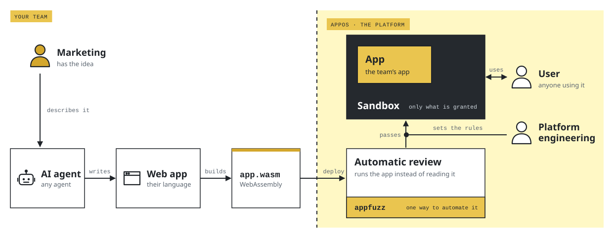
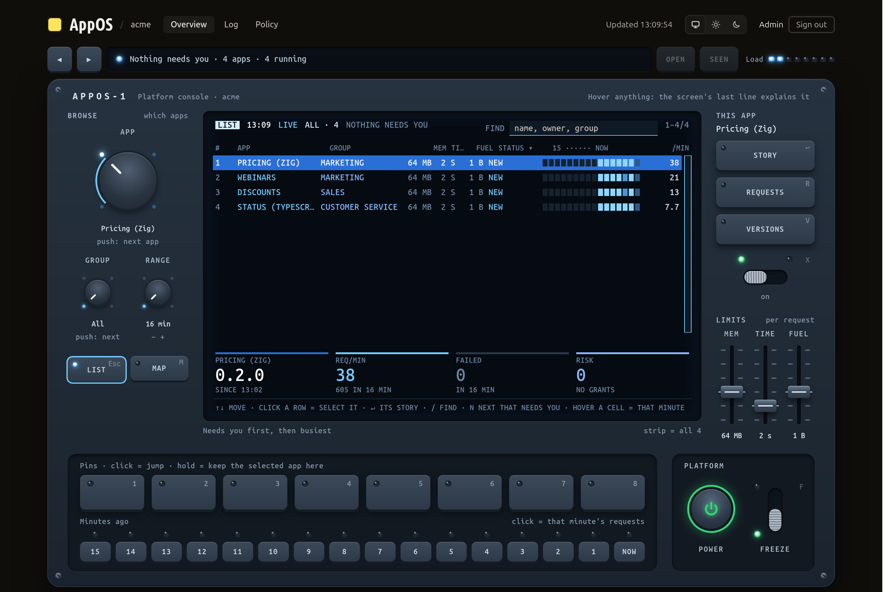

# AppOS

Marketing ships to production, and so do sales, customer service and
anyone else with an idea and an AI agent. That takes shift left to the
extreme, since development moves to the people who need the app. AppOS is
one way to make it safe. Each idea is its own small app. Before it goes
live it is checked and, where needed, hardened; [appfuzz](https://appfuzz.dev)
is one way to automate that check. WebAssembly sandboxes the app, and it
may do only what its manifest grants and the policy lets its users do.
Engineering owns the platform and gardens the live apps: it sees every
app, who owns it, what it may do and how it runs, checks its packages for
known vulnerabilities, and can limit it, roll it back or turn it off.

<picture>
  <source media="(prefers-color-scheme: dark)" srcset="docs/marketing-ships-dark.svg">
  
</picture>

## Install

```sh
brew install stephanschmidt/appos/appos   # appos and appos-shell, macOS and Linux
```

Or build them from source with Rust 1.100+ and
`rustup target add wasm32-wasip2`:

```sh
make            # the shell, the CLI, the hello world and the Rust examples, with their checks
make run        # the shell with the hello world at http://127.0.0.1:8080
```

`make typescript`, `make zig` and `make java` check the other languages.

## Building an app

```sh
appos new events --group Marketing  # a working hello world in ./events (--ts, --java)
cd events
appos dev                           # http://127.0.0.1:8080/events; changes rebuild and reload
appos guide                         # how apps work
```

`appos` with no arguments explains itself, and telling an agent "use the
appos CLI to build an app" is meant to be enough. The shell calls an app's
`init()` once and its `start()` for each request, in a fresh sandbox; the
app builds the page with host calls like `page::set-html` and `kv::get`
([docs/apps.md](docs/apps.md)).

## Hardening

Hardening means checking an app before it goes live and fixing what the
check finds. `appos review` sets up the review: the shell writes the
appfuzz manifest (grants, kv costs, the I/O budget, fuel, memory) and
takes the data and one request per route from what you did in `appos
dev`. [appfuzz](https://appfuzz.dev), one way to automate the review, runs
it; `appos review` prints the command. A shell started with `--review`
reviews every deploy and makes it live only when the review passes.

## Deploying

```sh
appos-shell --name demo              # http://127.0.0.1:8080; prints a link that signs you in as admin
appos login http://127.0.0.1:8080    # open the link, then paste a token from /admin/token
cd events && appos deploy            # http://127.0.0.1:8080/events
```

An app travels as one file, app.zip, and app.toml names its owner and its
group, and says what data the app keeps, where and why; a deploy without
them is refused. Each deploy is a new version that
never changes. `appos versions` lists them and `appos rollback` goes back.
If the live version fails 5 requests within a minute, the shell rolls back
by itself and holds new deploys until an admin makes a version live.
[docs/deploying.md](docs/deploying.md) has platforms, tokens, versions and
the log.

## Who may do what

An app's grants say what the app may do. The platform's policy says which
people may make it do that, under the same names. A host call goes through
only if both allow it, and the app checks nothing itself.

```
# policy.csv: p, who, where, what
p, anyone, webinars, kv-read
p, signed-in, webinars, kv-write
p, group:platform, *, admin-*
p, group:marketing, apps:Marketing, admin-deploy
```

The last line lets marketing deploy and roll back the apps of its group,
and nothing else: not another team's apps, not Freeze or Stop all.

People sign in through OIDC, a proxy's headers or a sign-in kit. Without a
sign-in and a policy, the shell runs on this machine only and prints a link
that signs you in as admin. [docs/access.md](docs/access.md) has the
policy, sign-in and the risk level of each grant.

## Running the apps



The admin screen at `/admin` shows every app with its owner, group,
grants, the data it keeps, versions and requests. An admin turns an app off, sets its limits
or makes an earlier version live there. Each request gets 1 billion
instructions, 64 MB memory, 100 I/O units and 2 seconds; a request over
budget stops, and the shell and the other apps keep running. `appos audit`
lists the live apps that use a package with a known vulnerability, with
their owners, for Rust and TypeScript apps so far.
[docs/operations.md](docs/operations.md) has the admin screen, the budgets
and the audit.

## Kits

Besides `page`, `kv` and `users`, apps call the platform's kits:
functions in WIT, each behind a grant. An app that holds a kit's grant
imports its interface and calls its functions like its own. AppOS checks
the app's grant and the policy before a call reaches the kit; a kit never
checks permissions itself.

<picture>
  <source media="(prefers-color-scheme: dark)" srcset="docs/kits-dark.svg">
  
</picture>

An illustration with two kits like [acme-platform](examples/acme-platform)'s
CRM kit and [acme-scoring](examples/acme-scoring). Solid arrows are queries,
which answer at once and only read; the dashed arrow is a command, which goes
out after the app's request commits.

A kit is Rust compiled into the platform, like the booking kit of
[kitewell](kitewell), or WebAssembly deployed like an app, which
`appos new crm --kit` starts. [docs/kits.md](docs/kits.md) has both kinds,
commands and how a kit calls other services.

## Layout

```
wit/appos.wit         the contract between shell and apps
wit-auth/auth.wit     the contract between shell and sign-in kits
shell/                the shell: library + appos-shell binary (axum,
                      wasmtime, SQLite for kv and the platform database)
cli/                  the appos CLI; runs the same shell for `appos dev`
cli/src/deps/         deps.json: the packages in an app, for `appos audit`
cli/template*/        the hello world in Rust, TypeScript and Java, and a kit
examples/             apps in Rust, TypeScript and Zig, each from a request,
                      a sign-in kit and a platform with kits
kitewell/             a SaaS on AppOS: a booking kit, apps by sales and product
docs/                 deploying, access, operations, apps and kits in detail
```
