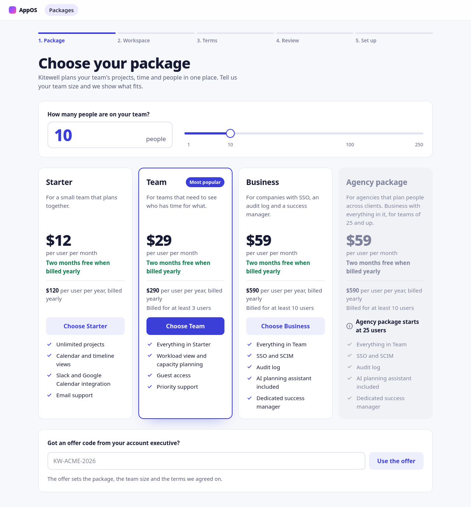

# Kitewell

Kitewell is a made-up SaaS company. It sells a planning tool for teams: projects, time and people in one place. The apps in [examples/](../examples) are the work around a company's product, like marketing's webinars or the sales team's discount approvals. This folder is the product itself. Engineering runs the platform in Rust, and two other teams change parts of it on their own: sales and product own pages of the booking flow as AppOS apps.

Sales and product changing the product themselves is a radical change in how a company works. AppOS is one way to make it safe, and Kitewell shows how that looks for a SaaS product.

Customers book a package on Kitewell's site. There is no payment: finance sends invoices, and nothing here does that part.

The other steps are in [screenshots/](screenshots), on a desktop and on a phone.

## The booking flow

| Step | Owner | Page | Grants of the app |
|---|---|---|---|
| 1 Package | Sales (Hannah Boateng) | `packages` app, /packages | booking-read, booking-choose, booking-terms |
| 2 Workspace | Product (Jonas Berg) | `workspace` app, /workspace/configure | booking-read, booking-configure, booking-setup |
| 3 Terms | Sales | `packages` app, /packages/terms | |
| 4 Review and book | Engineering | the platform's page, /book/&lt;draft&gt; | |
| 5 Set up | Product | `workspace` app, /workspace/setup | |

Engineering keeps what has to be right every time. The prices, the limits and the approved offers are in [src/catalog.rs](src/catalog.rs), and the drafts and bookings in [src/store.rs](src/store.rs). The booking itself happens on the review page. No function takes a price: an app sets the plan, the team size, the add-ons and the terms, and the platform calculates the quote. A function that says no gives its reason in words ("Starter is for up to 10 users"), and the apps show it as it is.

Sales and product decide how their steps look and what they ask. [packages/request.md](packages/request.md) and [workspace/request.md](workspace/request.md) are their requests, written the way a sales ops lead and a product manager would write them. One wish is left out: product asked for a Copy button next to each invite link. Apps can't run scripts of their own on AppOS, so the link is in a field to select and copy.

## How the parts fit

The platform is the AppOS shell with one kit, `kitewell:booking` ([wit/booking.wit](wit/booking.wit), [src/booking.rs](src/booking.rs)). Each step has its own interface and its own grant. An app holds grants in its app.toml, and [policy.csv](policy.csv) says who may use them in which app. AppOS checks both before a call reaches the kit, so the sales app can read the workspace step but can't change it.

A booking in progress is a draft. Its id is hard to guess, and the pages pass it on in their links (`?draft=`). `flow.next` tells a page where the customer goes after it.

The platform has a plain page of its own for every step ([src/pages.rs](src/pages.rs), at /book/&lt;draft&gt;/&lt;step&gt;). While an app doesn't serve, because it is paused, rolled back or not deployed, `flow.next` sends customers to the platform's page for that step. Sales can pause their app and customers still book.

## Run it

Rust, Node 24 and zig (for the TypeScript app), and the `appos` binary of this repo:

    cargo build -p kitewell -p appos
    export PATH=$PWD/target/debug:$PATH
    (cd kitewell/packages && appos build)
    (cd kitewell/workspace && npm install && appos build)
    cd kitewell && kitewell --dev packages workspace

Then open http://127.0.0.1:8080/book. It goes to the sales app's package page. Pressing Enter reloads the apps after a rebuild. Leave out `workspace`, or `packages`, and the platform's own pages take over their steps.

Try the offer codes KW-ACME-2026 and KW-NORDLICHT-2026, and KW-POLAR-2025, which expired. Drafts and bookings are kept in memory, or in a SQLite file given as `KITEWELL_DB`.

In production the platform runs with sign-in and the policy, `--auth auth.toml --policy policy.csv`. Customers book without signing in, so policy.csv gives the booking grants to `anyone`, each one only in the app that needs it.

## Files

    wit/booking.wit       the kit's interface, what apps build against
    src/main.rs           the platform: the shell, the kit, where each step's page is
    src/booking.rs        the kit: its functions and grants
    src/catalog.rs        plans, prices, offers and the quote
    src/store.rs          drafts, offers, bookings and members in SQLite
    src/pages.rs          the platform's own pages at /book
    templates/            their templates, and the stylesheet every page shares
    screenshots/          the five steps of a booking
    policy.csv            who may use which grant in which app
    packages/             the sales team's app, Rust
    workspace/            the product team's app, TypeScript
